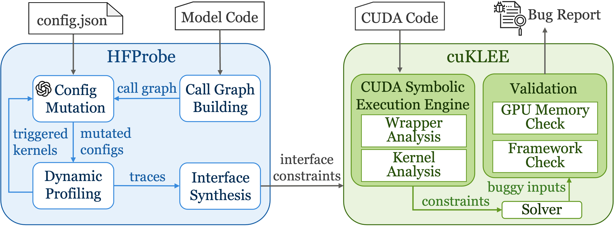

<h1 align="center">M2K</h1>

<p align="center">
  <b>Find bugs in the CUDA kernels used in LLM inference.</b>
</p>

<p align="center">
  <a href="https://github.com/vllm-project/vllm/security/advisories/GHSA-7m6h-x95x-82q5"></a>
  <a href="#citation"></a>
  <a href="LICENSE"></a>
</p>

<p align="center">
  <a href="#bugs-found-by-m2k">Bugs Found</a> •
  <a href="#how-it-works">How It Works</a> •
  <a href="#quick-start">Quick Start</a> •
  <a href="#documentation">Documentation</a> •
  <a href="#citation">Citation</a>
</p>

---

M2K finds bugs in the CUDA kernels that LLM inference runs on, both the kernels inside serving frameworks such as **vLLM** and **SGLang** and the custom kernels that ship with models. It detects **integer overflows**, **out-of-bounds accesses**, **null pointer dereferences**, and **data races**.

Whether a kernel misbehaves depends on the inputs the model gives it. **M2K makes this model-kernel interface explicit**: it infers how each kernel's arguments depend on the model config and request shape, symbolically executes the kernel under those constraints, and validates every report on the real model.

## Bugs Found by M2K

So far, M2K has found **60 bugs**: **48 in vLLM**, **8 in SGLang**, and **4 in custom kernels shipped with Hugging Face models**. Of these, 35 are integer overflows and 25 are out-of-bounds accesses. **43 have been confirmed or fixed by developers** (17 of them fixed), and an integer overflow in vLLM's activation kernels was assigned **CVE-2026-73558**. The table below lists the bugs we have reported; one report may cover several kernels in the same file.

| Framework | Bug Type | Report | Status | Security Advisory |
| :--- | :--- | :--- | :--- | :--- |
| **vLLM** | Integer overflow | [#42860](https://github.com/vllm-project/vllm/issues/42860) | ✅ Fixed ([#49660](https://github.com/vllm-project/vllm/pull/49660)) | [GHSA-7m6h-x95x-82q5](https://github.com/vllm-project/vllm/security/advisories/GHSA-7m6h-x95x-82q5)<br>[CVE-2026-73558](https://www.cve.org/CVERecord?id=CVE-2026-73558) |
| **vLLM** | Integer overflow | [#40905](https://github.com/vllm-project/vllm/issues/40905) | ✅ Fixed ([#41617](https://github.com/vllm-project/vllm/pull/41617)) | — |
| **vLLM** | Integer overflow | [#22419](https://github.com/vllm-project/vllm/issues/22419) | ✅ Fixed | — |
| **vLLM** | Integer overflow | [#27911](https://github.com/vllm-project/vllm/issues/27911) | ✅ Fixed | — |
| **vLLM** | Integer overflow | [#42862](https://github.com/vllm-project/vllm/issues/42862) | 🟢 Confirmed | — |
| **vLLM** | Integer overflow | [#43390](https://github.com/vllm-project/vllm/issues/43390) | 🟢 Confirmed | — |
| **vLLM** | Integer overflow | [#45373](https://github.com/vllm-project/vllm/issues/45373) | 🟢 Confirmed | — |
| **vLLM** | Integer overflow | [#45469](https://github.com/vllm-project/vllm/issues/45469) | 🟢 Confirmed | — |
| **vLLM** | Integer overflow | [#45500](https://github.com/vllm-project/vllm/issues/45500) | 🟢 Confirmed | — |
| **vLLM** | Integer overflow | [#45884](https://github.com/vllm-project/vllm/issues/45884) | 🟢 Confirmed | — |
| **vLLM** | Out-of-bounds | [#45377](https://github.com/vllm-project/vllm/issues/45377) | 🟢 Confirmed | — |
| **vLLM** | Out-of-bounds | [#45380](https://github.com/vllm-project/vllm/issues/45380) | 🟢 Confirmed | — |
| **vLLM** | Out-of-bounds | [#45462](https://github.com/vllm-project/vllm/issues/45462) | 🟢 Confirmed | — |
| **vLLM** | Out-of-bounds | [#45492](https://github.com/vllm-project/vllm/issues/45492) | 🟢 Confirmed | — |
| **vLLM** | Out-of-bounds | [#45496](https://github.com/vllm-project/vllm/issues/45496) | 🟢 Confirmed | — |
| **vLLM** | Out-of-bounds | [#27917](https://github.com/vllm-project/vllm/issues/27917) | 🟢 Confirmed | — |
| **vLLM** | Out-of-bounds | [#27915](https://github.com/vllm-project/vllm/issues/27915) | 📨 Reported | — |
| **vLLM** | Out-of-bounds | [#27810](https://github.com/vllm-project/vllm/issues/27810) | ♻️ Code refactored | — |
| **Qwen/Qwen-1_8B-Chat** <sub>(Hugging Face)</sub> | Integer overflow | Reported privately | 🟢 Confirmed | — |
| **SGLang** | Integer overflow | [#29597](https://github.com/sgl-project/sglang/issues/29597) | 🟢 Confirmed | — |
| **SGLang** | Integer overflow | [#29602](https://github.com/sgl-project/sglang/issues/29602) | 🟢 Confirmed | — |
| **SGLang** | Integer overflow | [#29603](https://github.com/sgl-project/sglang/issues/29603) | 🟢 Confirmed | — |
| **SGLang** | Integer overflow | [#29605](https://github.com/sgl-project/sglang/issues/29605) | 🟢 Confirmed | — |
| **SGLang** | Integer overflow | [#29606](https://github.com/sgl-project/sglang/issues/29606) | 🟢 Confirmed | — |

<sub>✅ Fixed: fix merged upstream · 🟢 Confirmed: acknowledged by developers · 📨 Reported: awaiting response · ♻️ Code refactored: the buggy code was removed in a later release</sub>

If you find a bug with M2K, we'd love to add it here. Please open an issue.

## How It Works

<p align="center">
  
</p>

M2K has two components:

- **[HFProbe](HFProbe/)** synthesizes the model-kernel interface. It builds a call graph from the model code to find the kernels the model can reach, uses an LLM to mutate `config.json` so that more of those kernels are triggered, and profiles each kernel call (argument shapes, dtypes, and values). From these traces it synthesizes interface constraints, for example "argument 0 has shape `[batch * seq_len, 896]`".
- **[cuKLEE](cuKLEE/)** is a symbolic execution engine for CUDA kernels built on [KLEE](https://klee-se.org/). It analyzes both the host-side wrapper and the kernel under the interface constraints, and reports integer overflows, out-of-bounds accesses, null pointer dereferences, and data races. A solver turns each finding into a concrete buggy input, which M2K validates in two steps: it checks that the input fits in GPU memory, then reruns the model in the framework with that config, batch size, and sequence length to confirm the bug.

## Quick Start

**Requirements:** Ubuntu 22.04, Python 3.10, CUDA 12.1, GCC 11. Detection does not need a GPU. See the [full requirements](docs/getting-started.md#1-system-requirements).

```bash
git clone https://github.com/system-pclub/M2K.git && cd M2K

# Option 1: native install
bash setup.sh && source env.sh

# Option 2: Docker
docker build --build-arg BUILD_JOBS="$(nproc)" --platform=linux/amd64 -t m2k-env .
docker run --platform=linux/amd64 -it m2k-env
```

Run cuKLEE on the bundled example, the FP8 quantization kernel in vLLM 0.9.0:

```bash
mkdir -p example/out
cuKLEE --timeout=3600 --cuklee-out-dir=example/out example/dynamic_scaled_fp8_quant.json
```

```text
cuKLEE: Bug Detected: vllm-0.9.0/csrc/quantization/fp8/common.cu:19: integer overflow
cuKLEE: Bug Detected: vllm-0.9.0/csrc/quantization/fp8/common.cuh:128: integer overflow
```

To run the whole pipeline on a model, from call-graph analysis to validation, follow the [walkthrough](docs/getting-started.md#3-walkthrough-finding-a-bug-in-dynamic_scaled_fp8_quant).

## Documentation

| Document | Contents |
| --- | --- |
| [Getting Started](docs/getting-started.md) | Requirements, installation, an end-to-end walkthrough of every HFProbe and cuKLEE command and its options, troubleshooting |
| [Artifact Evaluation](docs/artifact-evaluation.md) | Scripts to reproduce every experiment in the SOSP 2026 paper |

## Citation

If you use M2K in your research, please cite our paper:

```bibtex
@inproceedings{m2k-sosp26,
  title     = {M2K: Making the Model-Kernel Interface Explicit for Reliable CUDA Kernel Verification},
  booktitle = {Proceedings of the 32nd ACM Symposium on Operating Systems Principles (SOSP)},
  year      = {2026}
}
```

## License

M2K is released under the [MIT License](LICENSE). cuKLEE is derived from KLEE, which is distributed under its own [license](cuKLEE/klee/LICENSE.TXT).
